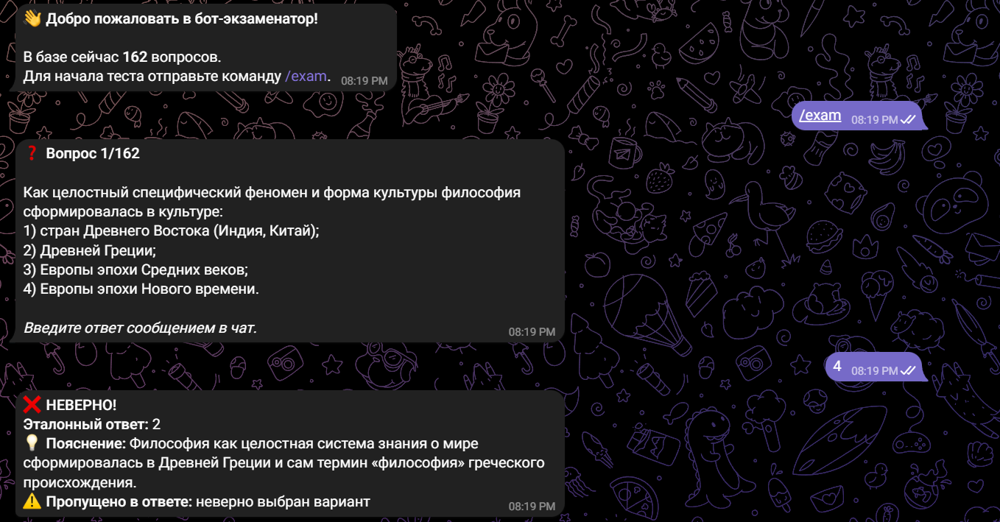

# 🤖 Local LLM Telegram Bot & Exam preparationn

> Telegram-бот с локальной языковой моделью для подготовки к экзамену. Срочный проект, реализован за 3 дня.
---

## 📌 О проекте (Overview)
Бот отправляет вопрос -> пользователь вводит ответ -> нейросеть обрабатывает контекст вопроса и ответа, далее выносит вердикт верно/неверно. Так же ИИ генерирует краткие пояснения после ответа и показывает на что опиралась при выводе. Это позволяет даже при галлюцинациях пользователю самостоятельно оценить верность ответа. 

### Ключевые возможности:
- 🧠 **Локальный инференс LLM** — работа без сторонних платных API и утечки данных.
- ⚡ **Приватность** — заказчик просил приватного бота для определенного круга лиц. Поэтому программа реализована через Telegram-ID (для больших компаний и аудитории 50+ человек такой вариант плох)
- 📊 **Экономия ресурсов** — Гибридная валидация (Fast checks + LLM): не тратится ресурс видеокарты/процессора там, где можно проверить регулярным выражением или точным совпадением.
- 💬 **Удобный интерфейс** — быстрые и простые сценарии в Telegram.

---

## 🛠 Tech Stack & Architecture

### Backend & Core
- **Language:** Python 3.10+
- **Asynchronous Framework:** `asyncio` (non-blocking I/O, background thread delegation via `asyncio.to_thread`)
- **HTTP & Networking:** `aiohttp` (custom session timeout management), `requests`

### Telegram Bot Framework
- **Framework:** `aiogram 3.x`
- **Architecture & State Management:** FSM (Finite State Machine) with `MemoryStorage`
- **Security & Access Control:** Custom outer middleware (`access_middleware`) for strict whitelist filtering by Telegram User ID
- **UX & Formatting:** HTML parse mode, automated chunking for long-form messages (>4000 chars)

### AI & LLM Integration
- **Engine / Runtime:** [Ollama](https://ollama.com/) (local inference API)
- **Model:** `Qwen 2.5 (1.5B)` fine-tuned/prompted via custom `Modelfile`
- **Prompt Engineering & Validation:** Structured JSON Output enforcement (`format: "json"`, temperature 0), fallback regex JSON parser, regex-based numeric and entity guards
- **Hybrid Verification Pipeline:** 
  - Fast-path deterministic evaluation (exact match, rule-based extraction, unit normalization)
  - LLM semantic inference for open-ended professional/customs exam answers

### Configuration & Data Management
- **Environment Management:** `python-dotenv`
- **Data Serialization:** JSON (`questions.json` dataset with strict validation schemas)
  
---

## 🖼 Демонстрация (Demo)

> *Совет: сделай 5-секундную гифку через ScreenToGif или скриншот диалога с ботом и положи в папку `assets/demo.png`.*

---

## 🚀 Быстрый старт (Getting Started)

### Предварительные требования
- Python 3.10 или выше
- Windows 10/11 с доступом к командной строке

### Установка и запуск

1. **Клонируйте репозиторий:**
bash

git clone https://github.com/<nogcoJlHyx>/<Local-LLM-Telegram-Bot-xam-preparation>.git

cd <Local-LLM-Telegram-Bot-xam-preparation>

2. **Создайте и активируйте виртуальное окружение:**
cmd

python -m venv venv

venv\Scripts\activate

3. **Установите зависимости:**
cmd

pip install -r requirements.txt

4. **Настройте переменные окружения:**
   Создайте файл `.env` на основе примера:
cmd
copy.env.example .env
Укажите ваш `BOT_TOKEN` и параметры модели.

5. **Запустите проект:**
   
cmd

python main.py
---

## 📁 Структура проекта (Architecture)
text

├── assets/ # Скриншоты и схемы

├── bot/ # Обработчики Telegram-событий

├── core/ # Интеграция с локальной LLM и логика MCP

├── services/ # Интеграция с CRM и аналитика OTIF

├── config.py # Конфигурация и переменные среды

├── requirements.txt # Список библиотек

└── main.py # Точка входа
